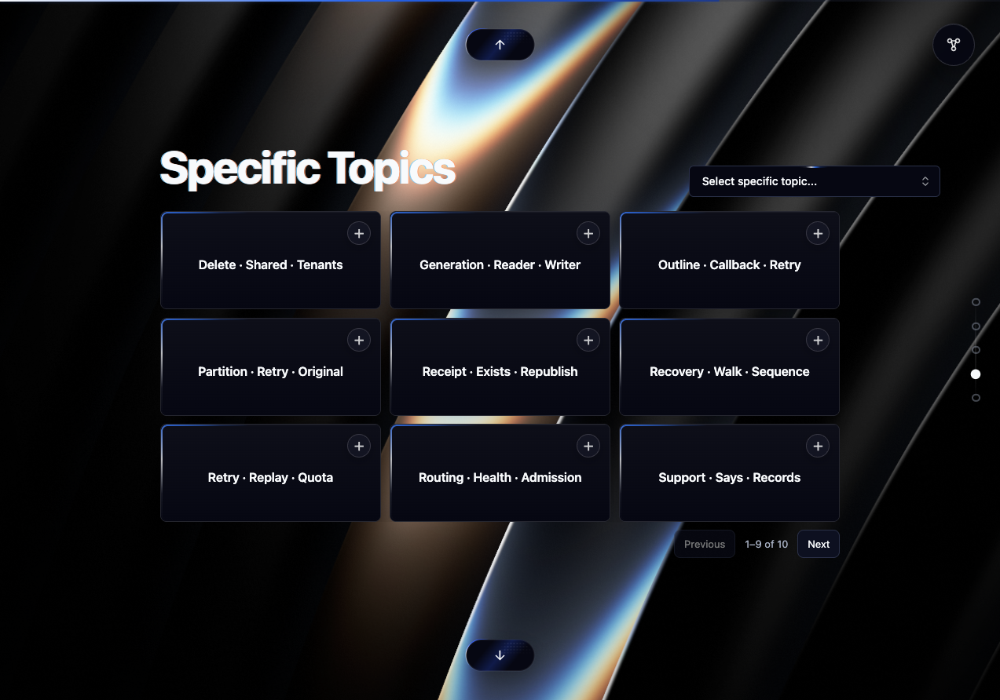

# Context Saver

Context Saver is a **Codex and Claude Code plugin for macOS, Linux, and Windows** with a browser viewer for your saved project chats. Search your conversations, browse from subjects down to individual messages, and choose which chats stay connected. Your coding agent can also recover earlier decisions and cite the original messages.

[Install the plugin](#install) · [Turn it off or on](#turn-it-off-or-on) · [Open the viewer](#open-the-viewer) · [Refresh existing topics](#refresh-existing-topics)

<a id="install-on-macos"></a>

## Install

Install [uv](https://docs.astral.sh/uv/getting-started/installation/) and make sure your coding client can find it on its PATH. Context Saver uses uv to select Python 3.12 and install its pinned runtime dependencies on first use.

Local embeddings feed UMAP + HDBSCAN directly for topic grouping. FastEmbed computes the embeddings, and USearch indexes them for retrieval. The [server requirements](plugins/thread-tree/server/requirements.txt) pin the runtime used by the plugin and manual commands.

Copy the commands for your client into a terminal.

### Codex

```sh
codex plugin marketplace add ajorge2/context-saver
codex plugin add thread-tree@context-saver
```

Review the Context Saver hooks in **Settings → Hooks** in the desktop app or with `/hooks` in the terminal UI. Start a new chat and attach **Context Saver** to begin saving that chat. You can send **Context Saver off** whenever you want to disconnect it from that chat.

### Claude Code

```sh
claude plugin install thread-tree --marketplace ajorge2/context-saver
```

Start a new Claude Code session in your project and run `/thread-tree:context-saver` to begin saving that chat. Run `/thread-tree:context-saver off` to disconnect it.

## Turn it off or on

**You control when Context Saver is connected to each chat.** Use **off** to stop saving new messages and stop the agent from looking up saved history in that chat. Existing saved context stays intact, and other chats keep their own connection settings.

| Client | Turn off | Reconnect | Check the connection |
|---|---|---|---|
| Codex app | Attach **Context Saver**, then send **off** or **Context Saver off** | Send **Context Saver on** | Send **Context Saver status** |
| Codex CLI | Select **Context Saver** from the `$` skill menu, then append `off` | Select it and append `on` | Select it and append `status` |
| Claude Code | `/thread-tree:context-saver off` | `/thread-tree:context-saver on` | `/thread-tree:context-saver status` |

A successful **off** command confirms:

> **Context Saver is OFF for this chat.** New messages won’t be saved and saved history won’t be used here. Existing saved context is kept.

Successful activation or **on** confirms **“Context Saver is ON for this chat.”** Use **status** whenever you want to check.

Off persists when you reopen the chat. Attaching the plugin or opening its viewer keeps that chat off until you explicitly reconnect it. **On** resumes saving from that point; it does not import the messages exchanged while off. **Status** checks the connection without activating it. The agent reports an unresolved chat identity or a blocked connection instead of claiming the command succeeded.

The viewer remains available while a chat is off. Its **Disconnect** action removes saved context after the memory update; use **off** when you want to keep it. Text already present in the coding agent’s active conversation remains there. [Control behavior and direct Terminal commands](docs/chat-controls.md)

## Open the viewer

- **Codex** — Attach **Context Saver** to a chat and send **Open Context Saver**.
- **Claude Code** — Run `/thread-tree:context-saver Open Context Saver` in your project.

The viewer opens with the most recently used connected project selected. Browse its subjects, broad topics, specific topics, and messages, or enter a search. If that project is removed, the next most recent available project takes its place.

For a simpler messages-only view, focus the search bar and select **M**. Only the search and Specific Messages slides remain. Message pages continue through the selected history. Click a card to inspect its sources, or open **Connections** to pause a chat or remove its saved context.



<details>
<summary>Open the viewer from Terminal</summary>

```sh
git clone https://github.com/ajorge2/context-saver.git
cd context-saver
uv run --no-project --python 3.12 --with-requirements plugins/thread-tree/server/requirements.txt python -X utf8 plugins/thread-tree/scripts/thread_tree.py serve --port 0 --open
```

Keep this Terminal window open while you use the viewer.

</details>

## Refresh existing topics

To rebuild an existing project's topic organization, attach Context Saver and ask **Refresh Context Saver topics**. In Claude Code, run `/thread-tree:context-saver Refresh Context Saver topics` from that project.

The refresh preserves saved messages, embeddings, and connection settings. The project must be selected and active. Installing an upgrade or opening the viewer does not refresh every existing tree. Topic counts and labels can change, and some evidence can remain unclustered. See the [repair notes and limitations](docs/browse-hierarchy-repair.md) for the Terminal command and verification scope.

## Ask for an earlier decision

Once a connected chat has some history, ask the agent a question like **“What condition did we agree on for retrying the deployment?”** Context Saver gives it relevant excerpts and their sources when the current conversation lacks that detail.

## Supported platforms

The [recorded native validation matrix](docs/platform-validation.md) used Codex CLI 0.157.1 and Claude Code 2.1.312 with fresh profiles, synthetic chats, and local test responses. The [browse and topic follow-up](docs/browse-hierarchy-repair.md#verification-scope) records its separate focused checks.

| Platform | Validated environment |
|---|---|
| macOS | macOS 15 on Apple Silicon |
| Linux x64 | Ubuntu 24.04 |
| Windows x64 | Native Windows Server 2025 |

The commands above work in Bash and PowerShell. If you just installed uv, restart your coding client so it picks up the updated PATH. On upgrade, review the changed hooks when Codex requests it. Existing saved messages stay available while Context Saver updates their local embeddings for the portable model.

## Where your data goes

The index and embedding model run locally. When the agent requests saved context, matching excerpts enter that coding host’s session and are handled according to its data settings.

## License

The release grants permission to install and run Context Saver. [Context Saver license](LICENSE) · [Bundled component notices](plugins/thread-tree/THIRD_PARTY_NOTICES.md)
