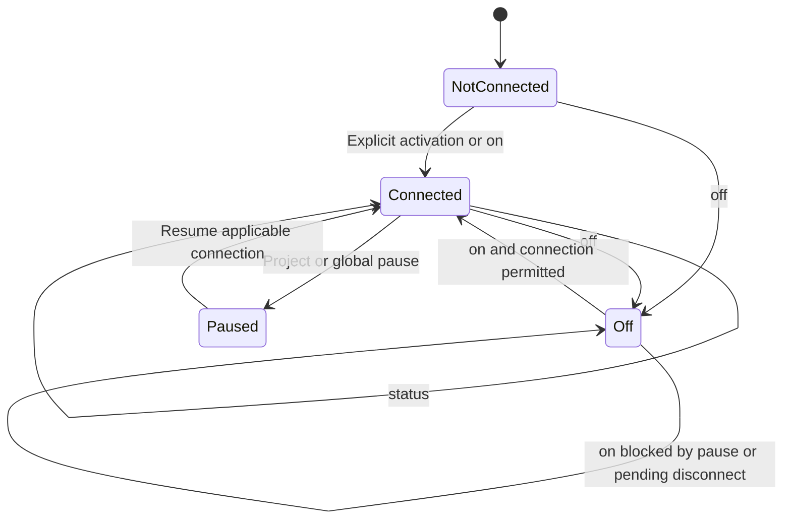

# Chat connection controls

Context Saver gives the user a persistent off switch for each chat. Turning it off stops new capture and saved-history lookup in that chat while preserving what was already saved. Another chat in the same project continues under its own connection settings.

## Commands users see

| Client | Off | On | Status |
|---|---|---|---|
| Codex app | Attach Context Saver, then send **off** or **Context Saver off** | **Context Saver on** | **Context Saver status** |
| Codex CLI | Select Context Saver from the `$` skill menu and append `off` | Append `on` | Append `status` |
| Claude Code | `/thread-tree:context-saver off` | `/thread-tree:context-saver on` | `/thread-tree:context-saver status` |

Successful off confirmation:

> **Context Saver is OFF for this chat.** New messages won’t be saved and saved history won’t be used here. Existing saved context is kept.

Successful activation or reconnection confirms **“Context Saver is ON for this chat.”** The agent reports that state only after the control or preparation succeeds.

Use **on** to reconnect. The command resumes capture from that point and does not import messages exchanged while off. **Status** checks the current connection without activating it. If the chat cannot be identified, the command reports that it could not confirm the change. An unavailable response must never be presented as successful disconnection.

Off is different from **Disconnect** in the viewer. Off is reversible and preserves saved context. Disconnect removes that source's saved context after its memory update. Opening the viewer remains possible while a chat is off and does not reconnect it. Off also cannot remove text already present in the coding agent's active conversation.

## State and identity



A control targets one canonical project path and one exact host chat identifier. The command may use an explicit ID or the identity provided by the current host. It never chooses a target by taking the globally most recent observed chat. Unknown or ambiguous identity fails safely instead of changing another chat. On additionally verifies the transcript before setting its resume boundary.

The explicit off state persists independently from first-time activation. Ordinary preparation respects it. The agent routes off, on and status before its normal preparation step; off and status never initialize or backfill the chat. Only on explicitly reconnects an off chat. A project-wide pause or pending disconnection can block reconnection, and the command reports that condition rather than overriding it.

## Capture and lookup boundaries

The durable per-chat control records its state, a generation and a capture watermark. Off prevents enqueueing new content for that chat and revokes unfinished ingestion claims. Already indexed messages and their embeddings remain intact.

On takes a verified snapshot of the transcript's current position. Future capture skips groups beginning at or before that watermark, including a dialogue crossing the boundary. This prevents the off interval and unfinished pre-off work from being imported later. Repeated on while already connected must preserve the established capture boundary.

Background work checks the chat's control state and generation before it publishes. Turning off and then on while an embedding task is running still invalidates that task's earlier generation. The checks use short consent-lock sections; an off command does not need to terminate a worker that serves other chats. History lookup checks the caller before searching and again before returning evidence, so a completed lookup cannot return saved excerpts after its originating chat was turned off during the search.

## Direct Terminal use

The chat controls are also real CLI subcommands. From a repository checkout, this example turns off one explicitly identified chat:

```sh
uv run --no-project --python 3.12 --with-requirements plugins/thread-tree/server/requirements.txt python -X utf8 plugins/thread-tree/scripts/thread_tree.py off --project '/absolute/project/path' --thread-id 'exact-host-chat-id' --json
```

Replace `off` with `on` or `status` for the other controls. Use the exact chat ID provided by the host. A terminal without a current host session needs the explicit identity; the command does not guess one from recent activity. There is no separate standalone `context-saver` executable to install.

The installed skill locates its own package and can use the same bundled command when an already-open host session has an older MCP tool inventory. Users can keep using the chat-level command. The adapter must preserve the user's project and exact chat identity and report the returned result faithfully.

## Implementation and verification

The shared handler lives in [thread_tree_tools.py](../plugins/thread-tree/scripts/thread_tree_tools.py), with capture controls enforced by [thread_tree_pipeline.py](../plugins/thread-tree/scripts/thread_tree_pipeline.py) and durable state in [thread_tree_state.py](../plugins/thread-tree/scripts/thread_tree_state.py). The [MCP server](../plugins/thread-tree/server/thread_tree_mcp.py), [CLI](../plugins/thread-tree/scripts/thread_tree.py) and [skill](../plugins/thread-tree/skills/context-saver/SKILL.md) expose the same behavior.

Release verification must cover off before activation, repeated commands, restart persistence, read-only status, missing identity, sibling-chat isolation, all three capture hooks, queued and in-flight work, off/on generation races, lookup interrupted by off, resume boundaries and existing-data preservation. CLI and MCP cases use disposable profiles and synthetic chats; native installed-host checks verify that the packaged control tool is available. Completed platform results belong in the [native validation record](platform-validation.md); this contract does not substitute for a test execution record.
