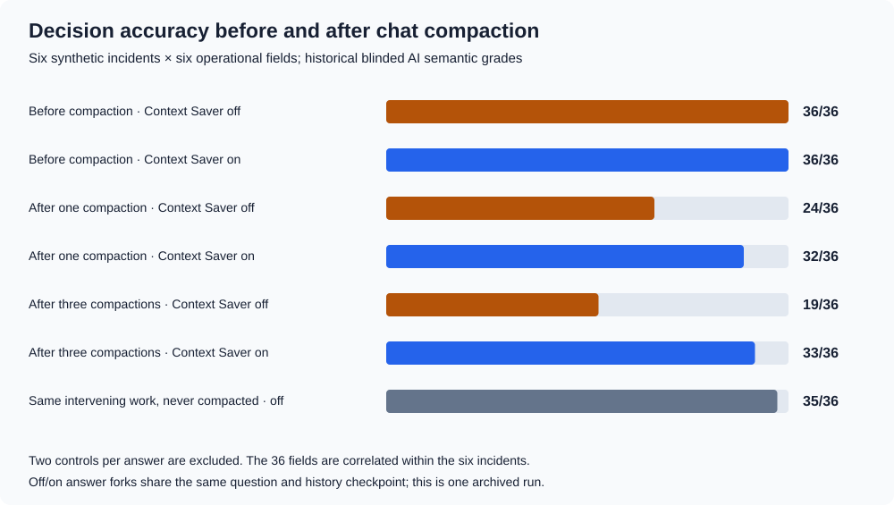
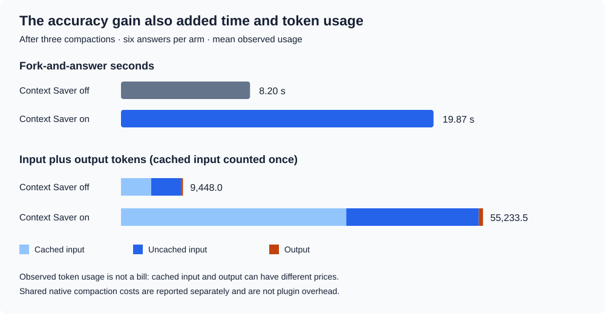

# Can a coding assistant retain project decisions after compaction?

Context Saver is a Codex and Claude Code plugin that lets an agent recover earlier project decisions from saved conversations. When a long chat is **compacted**, the coding host replaces earlier conversation content with a shorter working representation. The broad plan may survive while an approved correction, exception, or required sequence of steps disappears. This experiment asks whether the agent can still apply those earlier decisions correctly when a developer returns with a new engineering problem.

The benchmark uses **six scripted Codex chats about the same simulated software deployment system**, covering staged releases, failure recovery, and customer data deletion. Each chat contains initial proposals, approved design revisions, and later engineering discussions. A follow-up question asks Codex to resolve a new problem using those earlier decisions. Each answer is scored against six requirements: what action to take, which object to use, the steps in order, the conditions for proceeding, who should be affected, and which earlier decision takes precedence.

Together, these form a **labeled dataset of six questions with six answer requirements each: 36 scored checks**. The linked data calls these requirements *operational decision fields*. **After each chat was compacted three times, Codex satisfied 33 of 36 requirements with Context Saver, compared with 19 without it.** The gain came with a mean **11.67 additional seconds and 45,786 additional observed tokens per answer**. Tokens are the units of text processed by the model; the report separates cached input from new input rather than treating the total as a dollar charge.

This is a published analysis of one fixed experiment, run on November 17, 2026. The 36 requirements are related checks within six questions about one project; they are not 36 independently sampled tasks. The scores describe this run, rather than a general accuracy rate for all coding tasks or a guarantee of safe implementation.

## Read the evidence at the level you need

| If you want to know… | Start here |
|---|---|
| What was tested, and what changed? | [The task](#what-the-assistant-had-to-do), [results](#results-at-each-compaction-checkpoint), and [case-by-case differences](#where-the-difference-came-from) below |
| Why was the experiment designed this way? | [Methodology: design, controls, grading, and scope](METHODOLOGY.md) |
| What exactly were the questions and correct rules? | [Six complete questions and their 36 scored answer requirements](CASEBOOK.md) |
| What did the assistant actually say? | [All six answer reports](analysis/cases/), with retained answer text, citations, and grades for every requirement under every condition |
| What was in the earlier chats? | [All six scripted conversations](analysis/chats/) and the [machine-readable dataset](data/fixtures.json) |
| Can I check the arithmetic myself? | [Generated results](analysis/results.md), [analysis script](analyze.py), and [machine-readable summary](analysis/summary.json) |
| Where did these records come from? | [Preserved experiment records](data/records.json), [run manifest](data/run-manifest.json), and [provenance and file hashes](data/provenance.json) |
| How do I read the data files or run the analysis? | [Data guide](DATA_GUIDE.md) and [offline reproduction instructions](REPRODUCING.md) |

The answer reports expose the exact answer strings and citation metadata retained by the original scorer. The archive retains Codex's answer text for each requirement, rather than the complete original response files.

## What the assistant had to do

The simulated deployment project is called **Meridian**. Its **state machine** defines the conditions under which the system may move from one situation to another. Its design separately tracks customer consent, which workers may act, which version is active, whether an operation succeeded, release health, and the order of incoming events. For example, renewing a worker's permission to run does not prove that it has caught up on data it missed during an outage.

Each chat supplies part of that project's design and debugging history: an initial proposal, the corrections that replaced it, and the approved rules. Later messages add staging reviews, performance observations, and operational handoffs without changing those approved rules. The follow-up question then returns the assistant to an unfinished engineering task, with a new timeline and observations that can be misleading. To answer correctly, Codex must connect the current problem to the earlier approved decisions and apply their exact conditions.

The questions were designed around the details that humans often refer back to indirectly: “the pause patch from a while ago,” “the old rehearsal note,” or “the queue stall we never finished.” A request about retrying a timed-out publish, for example, requires recovering the original operation identifier, the receipt that establishes whether it succeeded, and the condition under which retrying is allowed. The earlier rules and scoring requirements were fixed before model testing.

In the questions below, a **canary** is a small trial release, a **lease** is temporary permission for a worker to act, and a **partition** is one subdivision of the data. A **committed** operation has been durably accepted; a missing or delayed display does not prove that it failed. The [casebook introduces the other recurring terms](CASEBOOK.md#choose-an-incident) before presenting the unedited technical questions.

| Case | Decision the question tests | Why generic engineering advice is insufficient |
|---|---|---|
| [One-sided canary pause](CASEBOOK.md#a-one-sided-canary-pause) | Keep an existing small rollout serving while withholding expansion. | Both health observers must watch the same **new** full interval; an old partial interval or an acknowledgment of the rollout request does not satisfy that rule. |
| [Publish timed out](CASEBOOK.md#a-publish-timed-out-after-issuing-a-receipt) | Reconcile a write that may already have committed. | The lookup must use the original operation and release version; a missing replica result does not justify retrying. |
| [Restored follower](CASEBOOK.md#a-live-writer-with-a-restored-follower) | Repair a reader without replacing the writer that is still serving. | Renewed permission to run does not prove the reader has caught up through the last accepted record or resolved every missing event. |
| [One-way key switch](CASEBOOK.md#recovery-after-a-one-way-key-switch) | Recover using the newer software after an irreversible security change. | An old healthy version cannot be reactivated, and health evidence must come from after routing was narrowed. |
| [Interrupted purge](CASEBOOK.md#a-tenant-was-disconnected-during-an-interrupted-purge) | Resume deletion after a crash without harming another customer's data. | The repair must keep the original job identity, block new data from the disconnected customer, remove their records and associated indexes, and save a rebuilt view of the surviving data. |
| [Quota refusal](CASEBOOK.md#quota-refusal-behind-a-proxy-during-partition-replay) | Retry a blocked event without violating order or authorization. | The signed retry time and original authorization version control eligibility; unrelated partitions may continue. |

Each of the six follow-up questions has a predefined answer rubric: a record of what a correct answer must include.

| Answer requirement | What must the answer establish? |
|---|---|
| Action (`disposition`) | What should happen now? |
| Target | Which version, operation, or component should be used? |
| Step order (`operations`) | Which steps must happen, and in what sequence? |
| Prerequisites (`gate`) | What must be verified before proceeding? |
| Affected scope | Which customers or components are affected, and which should continue working? |
| Controlling source (`authority`) | Which earlier approved rule or record takes precedence over conflicting information? |

These requirements define what reviewers check in each answer. A requirement passes only when every material part of its approved rule is present. A **complete answer** satisfies all six requirements; the tables also count how many individual requirements passed. Two additional controls checked a working branch stated in the current question and an external ticket ID that was never recorded. Both controls passed in every answer and are excluded from the 36 scored requirements. [Field definitions and exact controls](CASEBOOK.md#how-to-read-these-cases)

The model answered the questions only. It did not build this fictional project, edit source files, or execute the suggested regression tests. This measures retention and application of project decisions, not implementation success.

## How the comparison worked

The run used **Codex CLI 0.157.1, `gpt-6-sol`, low reasoning effort**. Each question used its own Codex chat and a separate local search index of the early decision records. Before compaction, after one compaction, and after three compactions, the test runner created two new chats from the same saved conversation state:

- **Without Context Saver:** answer using the chat context Codex still had available.
- **With Context Saver:** answer from the same checkpoint, with access to the real read-only project-history search tool. The agent could choose whether and how to retrieve, including parallel independent searches.

A separate comparison answered **all six questions** after identical later discussion **without compacting the chats and without Context Saver**. Across those six answers, Codex satisfied 35/36 requirements, showing that nearly all the requested information remained answerable from the full conversations. For each of the six questions, Codex answered under seven conditions: with and without the plugin before compaction, after one compaction, and after three compactions, plus the uncompacted comparison. This produced **42 answers in total**. Earlier test answers were kept out of the continuing chats, preventing later answers from simply repeating a previous test response.

| Design choice | What it helps distinguish |
|---|---|
| Identical question and saved conversation state for each with/without pair | Check what changes when history search is available while the question and prior context stay fixed. |
| Baseline before compaction | Establish whether Codex could apply the rules when the earlier discussion was still available. |
| One and three compactions performed by Codex | Observe how answer quality changes after repeated reductions of the same chat history. |
| Same later discussion, no compaction | Check whether the errors follow compaction rather than merely having more discussion in the chat. |
| Separate search indexes containing only the authored early conversations | Keep the available evidence limited to the relevant test chat, with no unrelated personal history. |
| Controls for a current fact and a fact never supplied | Check that Codex can read current information and avoid inventing an unsupported answer. |
| Predefined answer requirements; reviewers not shown the test condition | Judge the answers against the earlier rules without knowing whether the plugin was available. |
| Time and token use reported with each score | Show the extra work required to obtain the measured improvement. |

These comparisons isolate history-search access within this authored workload. The dataset still contains six related engineering questions about one simulated project, each answered once per condition. The runner deliberately requested Codex's native compaction operation at scheduled points. It did not wait for a chat to reach the context limit and compact automatically. [Full method and replay boundaries](METHODOLOGY.md)

## Results at each compaction checkpoint



| Checkpoint | Without Context Saver | With Context Saver | Questions correct in full, without / with |
|---|---:|---:|---:|
| Before compaction | 36/36 · 100.0% | 36/36 · 100.0% | 6/6 / 6/6 |
| After one compaction | 24/36 · 66.7% | 32/36 · 88.9% | 1/6 / 3/6 |
| After three compactions | 19/36 · 52.8% | 33/36 · 91.7% | 1/6 / 3/6 |
| Same scripted work, no compaction | 35/36 · 97.2% | Not run | 5/6 / — |

After three compactions, the answers with Context Saver satisfied **15 requirements** missed by their paired answers without it, but failed **one requirement** that the comparison answered correctly. That is a net gain of **14/36 requirements, or 38.9 percentage points**. Both conditions chose the correct broad action in **5 of 6 questions**. The gain was in making the recommendation specific enough to follow: which object to act on, which steps come first, what must be checked, whose work is affected, and which earlier rule controls the decision.

Without the plugin, Codex answered `UNKNOWN` for **nine requirements whose answers were present in the earlier history**. With the plugin, it did so for **zero**. For the deliberately unrecorded approval ID, `UNKNOWN` was the correct response in both conditions.

These scores reproduce the saved AI reviewers' judgments; the [grading section](#how-the-grades-were-produced) explains how those judgments were made. [Complete generated tables and calculations](analysis/results.md) · [Machine-readable source records](data/records.json)

## Where the difference came from

Each score below counts how many of the same six answer requirements were satisfied after the third compaction. The links open the preserved answers beside the governing rules and grades.

| Question | Without | With | Requirements corrected with Context Saver | Requirements still marked incorrect with Context Saver |
|---|---:|---:|---|---|
| [Canary pause](analysis/cases/stale-canary.md) | 2/6 | 6/6 | Step order, prerequisite evidence, affected scope, controlling source | None |
| [Ambiguous publish](analysis/cases/ambiguous-commit.md) | 1/6 | 5/6 | Target, step order, affected scope, controlling source | Action |
| [Restored reader](analysis/cases/stale-rejoin.md) | 2/6 | 6/6 | Step order, catch-up prerequisite, affected scope, controlling source | None |
| [One-way key change](analysis/cases/post-seal-recovery.md) | 3/6 | 6/6 | Recovery target, step order, health prerequisite | None |
| [Interrupted purge](analysis/cases/purge-restart.md) | 6/6 | 5/6 | None; step order regressed | Order |
| [Quota retry](analysis/cases/signed-backoff.md) | 5/6 | 5/6 | None | Order |

For a concrete example, the [key-change question](CASEBOOK.md#recovery-after-a-one-way-key-switch) presented a record of a healthy old release after a security change had made reactivating it invalid. Without the plugin, Codex correctly avoided returning to the old release but could not identify which newer release was eligible for recovery or what health checks were required. With Context Saver, Codex identified the last signed healthy release using the new key and required two clean observation periods under real traffic **after** the traffic-routing change. It also recovered the required sequence: narrow traffic routing, verify the recovery release, and reopen admissions only after those checks passed. Read the [disabled answer](analysis/cases/post-seal-recovery.md#r3_off), [enabled answer](analysis/cases/post-seal-recovery.md#r3_on), and [original conversation](analysis/chats/post-seal-recovery.md).

The [interrupted-deletion regression](analysis/cases/purge-restart.md#r3_on) shows where performance worsened. The answer with the plugin said to block “generation 14 ingestion,” while the answer without it explicitly included a delayed event from generation 13. The approved rule blocks incoming data from that disconnected customer, including delayed events from earlier generations; otherwise deleted data could be reintroduced. The saved AI review marked the enabled answer's step-order requirement incorrect. Both versions of the [quota-retry answer](analysis/cases/signed-backoff.md) also omitted updating the record of the last processed event after the retry succeeded. The report preserves failures alongside gains.

This breakdown separates choosing the right action from recovering the requirements for carrying it out correctly:

| Answer requirement (data field) | Without after three compactions | With after three compactions |
|---|---:|---:|
| Action (`disposition`) | 5/6 | 5/6 |
| Target: which object to use | 4/6 | 6/6 |
| Steps in order (`operations`) | 1/6 | 4/6 |
| Prerequisites (`gate`): conditions for proceeding | 3/6 | 6/6 |
| Scope: who should be affected | 3/6 | 6/6 |
| Controlling source (`authority`) | 3/6 | 6/6 |

## Accuracy had a measurable cost



| Mean per answer | Before compaction, without / with | After one, without / with | After three, without / with |
|---|---:|---:|---:|
| Wall time, including fork and setup | 7.56 / 7.54 s | 9.23 / 17.29 s | 8.20 / 19.87 s |
| Observed total tokens | 8,996 / 9,766 | 9,116 / 32,715 | 9,448 / 55,234 |

At the third checkpoint, the mean enabled-minus-disabled difference was **+11.67 seconds** and **+45,786 total tokens per answer**. The token difference includes approximately **29,760 cached input**, **15,688 uncached input**, and **337 output** tokens; separately rounded components need not add exactly to the rounded total. Observed total tokens are not a dollar-cost estimate: cached input and uncached input have different billing implications, and no pricing conversion is applied here.

The final enabled answers made **19 history searches across four of six answer turns**, returning verified source evidence for **24 answer requirements**. The mean individual search took **243 ms**. End-to-end answer time also includes the model's additional requests and provider scheduling, so search latency alone does not describe the user-facing overhead. Two enabled final answers made no search; “enabled” means the tool was available, not that every answer used it.

The native experiment took **77 seconds wall time** because the six cases and paired answer forks ran concurrently. This is the elapsed time for the native run, not the sum of answer latencies or the time spent designing and reviewing the study. The 18 native compactions were shared checkpoints for the paired conditions; their costs are recorded separately rather than charged twice to the comparison. [Telemetry, concurrency, and cost definitions](METHODOLOGY.md) · [Derived cost tables](analysis/results.md)

## How the grades were produced

The first scoring pass looked for exact preapproved phrases. It rejected equivalent wording so heavily that it marked every broad action wrong, including answers given before compaction. Those initial scores are retained in the [archived records](data/records.json); they are **not** the 19/36 and 33/36 results reported here.

The reported scores instead use a later **blinded, meaning-based review**. Two AI reviewers compared the answers with the previously established requirements, each reviewing three questions. They were not shown whether a response used the plugin, how many compactions preceded it, or its citations. Equivalent wording could pass, but every material part of a requirement had to be present. Each question had **one reviewer**, so the grades were not independently duplicated or established by human consensus.

The archive contains the reviewers' pass/fail labels for each requirement, without an explanation for every judgment. Readers can inspect each label against the preserved answer and earlier rule, including the [ambiguous-publish action marked incorrect](analysis/cases/ambiguous-commit.md#r3_on). The offline analysis reproduces the published labels and arithmetic without silently regrading them. [Detailed grading method](METHODOLOGY.md) · [All answer reports](analysis/cases/)

## What this experiment establishes

The result supports a focused engineering claim: **in these six chats about one simulated deployment system, Context Saver helped Codex recover the earlier rules needed to answer new engineering questions correctly after compaction.** With the same later discussion and no compaction, Codex without the plugin satisfied 35/36 requirements; after three compactions, that fell to 19/36. With Context Saver available after three compactions, the score was 33/36, with additional time and token use.

The study covers one model configuration, one run, one fictional project, and manually triggered native compactions. It measures structured decisions rather than completed patches. The dataset does not measure production reliability, performance across other agents or projects, indexing speed over time, or a general overhead budget. Additional runs, independent projects, human grading, and implementation-level outcomes would test those separate claims.

## Inspect or recompute without an agent account

The saved records, authored conversations, reports, and calculations are included in this directory. Reviewing them does not require a Codex login, access to a private project, or another paid model run. Run the included offline analyzer from this directory to regenerate the derived tables and figures:

```sh
python3 analyze.py
python3 verify.py
```

The historical model run and blinded AI judgments are saved observations; rerunning arithmetic does not rerun the model or reproduce identical future answers. The [reproduction guide](REPRODUCING.md) distinguishes the offline audit from the environment needed for a new model experiment, including which historical artifacts are unavailable.

[Return to the plugin README](../../README.md) · [Read the exact questions](CASEBOOK.md) · [Open the complete generated results](analysis/results.md) · [Automated calculation checks](https://github.com/ajorge2/context-saver/actions/workflows/benchmark-analysis.yml)
