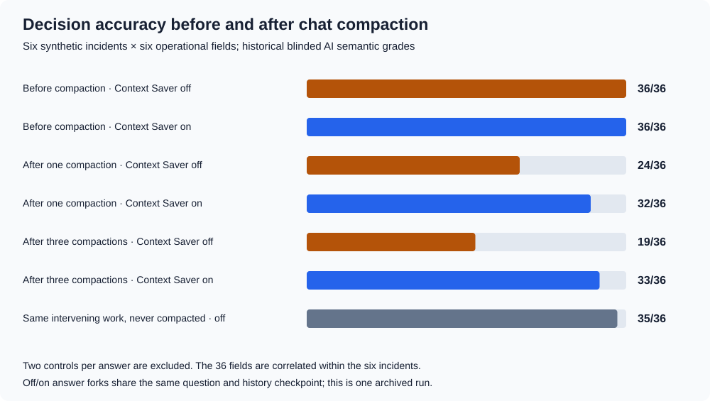
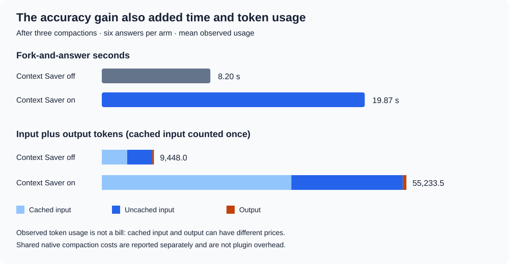

# Recomputed benchmark results

Context Saver is a plugin that lets a coding agent search earlier project chats. This experiment compares answers about earlier project decisions with and without that search after the chats were compacted. Compaction is the coding assistant’s reduction of older conversation context to fit its working context.

[Research overview](../README.md) · [File guide](../DATA_GUIDE.md) · [Method](../METHODOLOGY.md) · [Reproduce the arithmetic](../REPRODUCING.md)

This report is generated entirely from the public archived records by `python3 analyze.py`. It makes no model calls and reads no current user history. The six incidents belong to an authored fictional software release controller. Compaction means the coding assistant reduces older conversation context to fit its working context.

After three native Codex compactions, the historical blinded AI grades credit **19/36 operational fields with Context Saver off** and **33/36 with it on**. Each incident contributes six fields: action, target, ordered operations, prerequisites, scope, and authority. Those fields are correlated; this is six synthetic incidents in one run, not 36 independent tasks or a population estimate.

## Conditions and denominators

Off and on answers at a checkpoint start from the same parent history and receive the same final question. Before compaction means the early decisions are still directly available. The final uncompacted control receives the same intervening work as the three-compaction arm, with no compaction.

| History checkpoint and plugin state | Operational fields | Complete incidents (all six fields) | Main action | Controls |
|---|---:|---:|---:|---:|
| Before compaction · Context Saver off | 36/36 | 6/6 | 6/6 | 12/12 |
| Before compaction · Context Saver on | 36/36 | 6/6 | 6/6 | 12/12 |
| After one compaction · Context Saver off | 24/36 | 1/6 | 4/6 | 12/12 |
| After one compaction · Context Saver on | 32/36 | 3/6 | 5/6 | 12/12 |
| After three compactions · Context Saver off | 19/36 | 1/6 | 5/6 | 12/12 |
| After three compactions · Context Saver on | 33/36 | 3/6 | 5/6 | 12/12 |
| Same intervening work, never compacted · off | 35/36 | 5/6 | 6/6 | 12/12 |

The two controls ask for a branch stated in the current question and an external approval ticket never supplied in the chat (`UNKNOWN` is correct). All 84 control fields passed across the 42 answers. They are deliberately excluded from the 36-field headline, because they do not measure retention of the older project decisions.

## Follow an incident from conversation to grade

Each incident page contains its exact final question, frozen rules and source excerpts, all seven retained field-level answers, citations, boolean grades, and answer-specific token/time usage. The chat link shows every authored source turn used by the run.

| Incident | After three compactions, off → on | Corrected / regressed fields | Inspect |
|---|---:|---:|---|
| A one-sided canary pause | 2/6 → 6/6 | 4 / 0 | [Answers and grading](cases/stale-canary.md#r3_off) · [Full authored chat](chats/stale-canary.md) |
| A publish timed out after issuing a receipt | 1/6 → 5/6 | 4 / 0 | [Answers and grading](cases/ambiguous-commit.md#r3_off) · [Full authored chat](chats/ambiguous-commit.md) |
| A live writer with a restored follower | 2/6 → 6/6 | 4 / 0 | [Answers and grading](cases/stale-rejoin.md#r3_off) · [Full authored chat](chats/stale-rejoin.md) |
| Recovery after a one-way key switch | 3/6 → 6/6 | 3 / 0 | [Answers and grading](cases/post-seal-recovery.md#r3_off) · [Full authored chat](chats/post-seal-recovery.md) |
| A tenant was disconnected during an interrupted purge | 6/6 → 5/6 | 0 / 1 | [Answers and grading](cases/purge-restart.md#r3_off) · [Full authored chat](chats/purge-restart.md) |
| Quota refusal behind a proxy during partition replay | 5/6 → 5/6 | 0 / 0 | [Answers and grading](cases/signed-backoff.md#r3_off) · [Full authored chat](chats/signed-backoff.md) |

## Which details changed?

| Operational field | Off after three compactions | On after three compactions |
|---|---:|---:|
| Action to take | 5/6 | 5/6 |
| Object or identity to use | 4/6 | 6/6 |
| Steps in the required order | 1/6 | 4/6 |
| Conditions before proceeding | 3/6 | 6/6 |
| Who is affected or preserved | 3/6 | 6/6 |
| Source that overrides conflicting evidence | 3/6 | 6/6 |

The paired comparison has **15 corrected**, **1 regressed**, **18 correct in both**, and **2 incorrect in both** operational fields. Net improvement is 14 fields. The main action itself passed in five of six incidents in both arms; much of the separation was in the details needed to carry out that action safely.

| Incident | Field | Change | Inspect both retained answers |
|---|---|---|---|
| A one-sided canary pause | Steps in the required order | corrected | [Off](cases/stale-canary.md#r3_off) · [On](cases/stale-canary.md#r3_on) |
| A one-sided canary pause | Conditions before proceeding | corrected | [Off](cases/stale-canary.md#r3_off) · [On](cases/stale-canary.md#r3_on) |
| A one-sided canary pause | Who is affected or preserved | corrected | [Off](cases/stale-canary.md#r3_off) · [On](cases/stale-canary.md#r3_on) |
| A one-sided canary pause | Source that overrides conflicting evidence | corrected | [Off](cases/stale-canary.md#r3_off) · [On](cases/stale-canary.md#r3_on) |
| A publish timed out after issuing a receipt | Object or identity to use | corrected | [Off](cases/ambiguous-commit.md#r3_off) · [On](cases/ambiguous-commit.md#r3_on) |
| A publish timed out after issuing a receipt | Steps in the required order | corrected | [Off](cases/ambiguous-commit.md#r3_off) · [On](cases/ambiguous-commit.md#r3_on) |
| A publish timed out after issuing a receipt | Who is affected or preserved | corrected | [Off](cases/ambiguous-commit.md#r3_off) · [On](cases/ambiguous-commit.md#r3_on) |
| A publish timed out after issuing a receipt | Source that overrides conflicting evidence | corrected | [Off](cases/ambiguous-commit.md#r3_off) · [On](cases/ambiguous-commit.md#r3_on) |
| A live writer with a restored follower | Steps in the required order | corrected | [Off](cases/stale-rejoin.md#r3_off) · [On](cases/stale-rejoin.md#r3_on) |
| A live writer with a restored follower | Conditions before proceeding | corrected | [Off](cases/stale-rejoin.md#r3_off) · [On](cases/stale-rejoin.md#r3_on) |
| A live writer with a restored follower | Who is affected or preserved | corrected | [Off](cases/stale-rejoin.md#r3_off) · [On](cases/stale-rejoin.md#r3_on) |
| A live writer with a restored follower | Source that overrides conflicting evidence | corrected | [Off](cases/stale-rejoin.md#r3_off) · [On](cases/stale-rejoin.md#r3_on) |
| Recovery after a one-way key switch | Object or identity to use | corrected | [Off](cases/post-seal-recovery.md#r3_off) · [On](cases/post-seal-recovery.md#r3_on) |
| Recovery after a one-way key switch | Steps in the required order | corrected | [Off](cases/post-seal-recovery.md#r3_off) · [On](cases/post-seal-recovery.md#r3_on) |
| Recovery after a one-way key switch | Conditions before proceeding | corrected | [Off](cases/post-seal-recovery.md#r3_off) · [On](cases/post-seal-recovery.md#r3_on) |
| A tenant was disconnected during an interrupted purge | Steps in the required order | regressed | [Off](cases/purge-restart.md#r3_off) · [On](cases/purge-restart.md#r3_on) |

The three enabled-arm failures remaining after three compactions are the immediate action in the ambiguous-publish case, the operation order in the interrupted-purge case, and the operation order in the quota-retry case. These are the archived grader labels. In particular, the ambiguous-publish answer explicitly mentions reconciliation hold; no reviewer rationale was archived to explain why that action field failed. The original judgment is retained for audit rather than silently rescored.

## Time, tokens, and retrieval work

Times include fork setup plus answer generation. Paired overhead is the on answer minus its off counterpart within the same incident, averaged across six incidents. Input token counts include cached input; total tokens equal input plus output. Cached input must not be added to total a second time. Reasoning output is likewise already included in output. These records are observed usage, not dollar bills.

| Mean per answer | Before: off / on | After one: off / on | After three: off / on |
|---|---:|---:|---:|
| Fork-and-answer seconds | 7.56 / 7.54 | 9.23 / 17.29 | 8.20 / 19.87 |
| Input plus output tokens | 8,996.0 / 9,766.2 | 9,115.8 / 32,715.3 | 9,448.0 / 55,233.5 |
| Cached input tokens (subset of input) | 6,485.3 / 5,376.0 | 4,608.0 / 23,082.7 | 4,608.0 / 34,368.0 |
| Uncached input tokens | 2,302.8 / 4,192.2 | 4,187.0 / 9,204.2 | 4,543.3 / 20,231.5 |
| Output tokens (includes reasoning) | 207.8 / 198.0 | 320.8 / 428.5 | 296.7 / 634.0 |
| Model requests | 1.00 / 1.00 | 1.00 / 2.33 | 1.00 / 3.50 |

After three compactions the mean paired increase is **11.67 seconds** and **45,785.5 input-plus-output tokens**: 29,760.0 cached input, 15,688.2 uncached input, and 337.3 output. The category values sum to total before display rounding.

The enabled final answers completed **19 history searches across 4 of six answers**, with no archived failed searches. Mean individual search latency was **242.8 ms**. Verified evidence was returned for 24 answer fields. This flag records evidence exposure, not proof of semantic correctness or perfect citation formatting. End-to-end overhead also includes extra model requests and provider scheduling; it is not explained by retrieval latency alone.

[Per-incident paired time/token measurements](paired-costs.csv) · [Every answer field and grade](answer-fields.csv) · [Condition totals](conditions.csv) · [Per-case scores](per-case.csv) · [Per-field scores](per-field.csv) · [Every paired field change](paired-changes.csv)

## Shared compaction work

Native compaction creates the shared checkpoint used by both answer arms. Its cost is recorded separately and is not added to the plugin's paired overhead.

| Compaction round | Histories | Mean seconds | Mean provider total tokens |
|---|---:|---:|---:|
| 1 | 6 | 6.99 | 18,899.0 |
| 2 | 6 | 6.49 | 18,782.3 |
| 3 | 6 | 8.20 | 19,038.8 |

## What this analysis verifies—and what remains a judgment

The script sums the saved boolean semantic grades, checks denominators, pairs the same incidents, and computes overhead from individual usage/timing records. The separate verifier checks these calculations against the historical cached summaries and rejects deliberately corrupted grades, token counts, costs, and missing records. It does not automatically regrade language or establish that every historical AI grading judgment was correct.

The initial exact-alias scorer rejected equivalent wording and even marked all baseline main actions wrong. Its original per-field outcomes are visible on the case pages and in the data; they are a diagnostic for the initial scorer, not the 33/36 semantic result. No rationale or adjudication transcript was archived for the later semantic judgments.

The public archive includes the authored source chats and retained answer fields, but not original full response envelopes, native compacted checkpoints, raw retrieval bodies, or all historical runtime source. It reproduces the data analysis offline; it cannot independently replay every historical provider event. The method, scope and missing evidence are documented in the [method](../METHODOLOGY.md) and [provenance record](../data/provenance.json).
